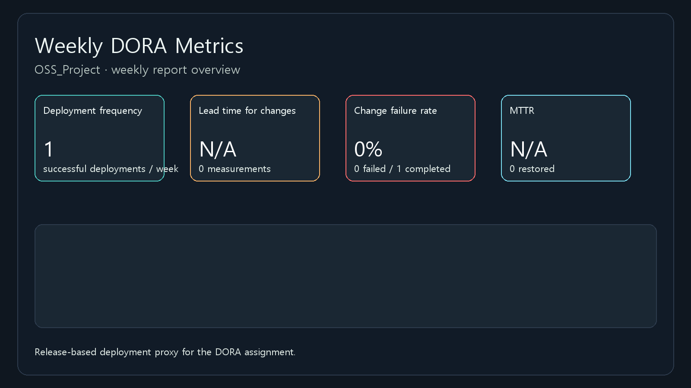

# OSS Project

오픈 소스 소프트웨어 개발 과정에서 GitHub 기반 협업, 자동화, 배포 관리를 실습하고, DORA 4대 지표를 계산하는 프로젝트입니다.

## 프로젝트 소개

이 저장소는 GitHub Actions와 GitHub API를 활용해, 팀의 개발 속도와 안정성을 정량적으로 확인하는 실습용 프로젝트입니다. 특히 다음과 같은 목표를 가집니다.

- GitHub 저장소를 기반으로 한 협업 실습
- 자동화 워크플로 작성 실습
- DORA 4대 지표 도입 및 계산
- 자동 주간 보고서와 대시보드 생성
- 배포/릴리즈/이슈 데이터를 바탕으로 한 운영 지표 분석

## 핵심 기능

- GitHub Actions 기반 자동 처리량 계산
- DORA 4대 지표 추적
- GitHub Release 및 이슈 데이터를 활용한 대리 지표 계산
- JSON 산출물 생성
- 주간 Markdown 보고서 생성
- Chart.js 기반 대시보드 생성
- GitHub Artifact로 결과물 보관

## 사전 준비 사항

- Python 3.x
- Git
- GitHub 계정
- GitHub Actions 사용 가능 저장소
- GitHub Desktop 또는 VS Code 권장

## DORA 지표 자동화

`.github/workflows/throughput.yml` 파일은 매주 일요일 00:00 UTC에 자동 실행되며, 필요할 때는 수동으로도 실행할 수 있습니다. 이 워크플로는 최근 7일 동안의 GitHub 데이터를 수집하고, DORA 4대 지표를 계산한 뒤 결과를 GitHub Actions 요약과 아티팩트로 남깁니다.

실행 과정은 다음과 같습니다.

1. 저장소와 GitHub API 데이터 수집
2. 배포/릴리즈 기반 지표 계산
3. 주간 처리량 계산
4. JSON, Markdown, HTML 대시보드 생성
5. `weekly-dora-report` 아티팩트로 업로드

## 산출물

워크플로가 실행되면 아래 파일들이 생성됩니다.

- `dora-metrics.json`: 원시 지표 데이터
- `weekly-report.md`: 주간 보고서
- `dora-dashboard.html`: Chart.js 기반 시각화

## 대시보드 미리보기

아래 이미지는 최신 실행 결과를 기반으로 생성된 DORA 대시보드입니다.

## DORA 4대 지표 정의

- 배포 빈도(Deployment Frequency)
  - 일주일 동안 얼마나 자주 성공적인 배포 또는 릴리즈가 발생했는지 측정합니다.

- 변경 리드 타임(Lead Time for Changes)
  - 변경이 시작된 시점부터 운영 배포 또는 릴리즈가 완료될 때까지 걸린 시간을 의미합니다.

- 변경 실패율(Change Failure Rate)
  - 배포나 릴리즈 중 실패가 발생한 비율을 의미합니다.

- MTTR(Mean Time to Restore)
  - 장애 또는 실패가 발생한 뒤 서비스를 복구하는 데 걸린 평균 시간을 의미합니다.

## 현재 구현 방식의 특징

이 저장소는 실제 배포 이벤트가 없어 GitHub의 배포 기록이 비어 있는 상태입니다. 따라서 현재 구현은 GitHub Release와 이슈 라벨을 기반으로 한 대리 지표 방식으로 동작합니다.

- 배포 빈도: Release 수를 기준으로 계산
- 리드 타임: Release 시간과 커밋 시점 비교
- 변경 실패율: `dora-failure` 라벨이 붙은 이슈와 관련된 Release 비율 계산
- MTTR: 실패 이슈 생성부터 종료까지 걸린 시간 계산

이 방식은 실제 배포가 없을 때 DORA 개념을 정량화하는 데 유용하지만, 실제 운영 환경의 배포 데이터와는 차이가 있을 수 있습니다.

## 실행 방법

1. 저장소에 변경 사항을 커밋합니다.
2. GitHub 저장소로 push합니다.
3. GitHub의 Actions 탭에서 `Weekly Throughput` 워크플로를 선택합니다.
4. `Run workflow` 버튼을 클릭하여 수동 실행하거나, 일정에 따라 자동 실행됩니다.
5. 실행 완료 후 `weekly-dora-report` 아티팩트를 다운로드하여 결과를 확인합니다.

## 결과물 활용

- 수업 보고서 작성
- GitHub Actions 자동화 실습 결과 기록
- DORA 개념 이해 및 비교 분석
- 운영 지표 관찰 및 팀 성과 해석

## 요약

이 프로젝트는 단순히 코드만 작성하는 수준을 넘어서, GitHub 기반 협업 흐름과 자동화된 지표 생성까지 함께 다루는 실습 형태입니다. 저장소 안에서 자동으로 DORA 지표를 계산하고, 결과를 아티팩트와 대시보드 형태로 남기도록 구성한 것이 핵심입니다.

